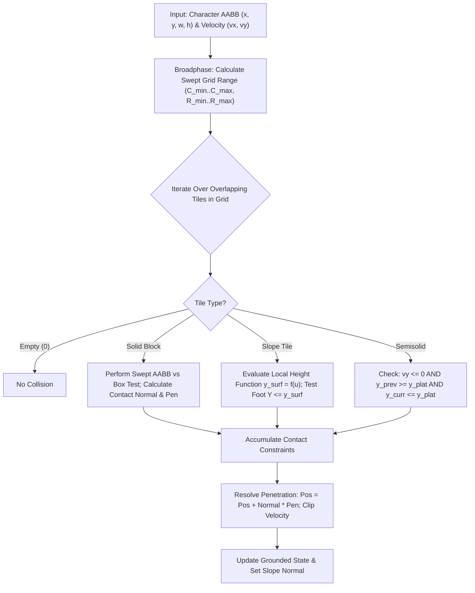

# New Super Mario Bros. U (NSMBU) Grassland Tileset: Architectural, Graphic, and Engine Specification

**Document Version:** 1.0.0  
**Source Asset:** `Wii U - New Super Mario Bros. U _ New Super Luigi U - Tilesets (New Super Mario Bros. U) - Grassland Tileset.png`  
**Target Environment:** 2D / 2.5D Tilemap Engine, Character Controller, & Physics Collision System  
**Resolution Standard:** High Definition (Wii U 720p native, 1080p presentation)

---

## 1. Exact Pixel Metrics & Grid Architecture

### 1.1 Master Sheet Dimensions & Spatial Layout
The master sprite sheet represents a dual-atlas texture pack ripped directly from *New Super Mario Bros. U / New Super Luigi U* (Acorn Plains / Grassland theme). The image dimensions and spatial layout are mathematically exact:

*   **Total Canvas Dimensions:** `1876 × 3230` pixels ($W \times H$).
*   **Color Format:** 32-bit RGBA (8 bits per channel).
*   **Framing & Border Margins:** The sprite sheet is surrounded and separated by a uniform **10-pixel padding margin** colored `#00AAFF` (`RGB(0, 170, 255)`), standard for The Spriters Resource rips.
    *   Left Border: $X \in [0, 9]$ (10 pixels width).
    *   Content Width: $X \in [10, 1865]$ (**1856 pixels width**).
    *   Right Border: $X \in [1866, 1875]$ (10 pixels width).
    *   Top Border: $Y \in [0, 9]$ (10 pixels height).
    *   Atlas 1 (Daytime Grassland): $Y \in [10, 1609]$ (**1600 pixels height**).
    *   Inter-Atlas Gutter / Divider: $Y \in [1610, 1619]$ (10 pixels height).
    *   Atlas 2 (Twilight / Night / Cave Grassland): $Y \in [1620, 3219]$ (**1600 pixels height**).
    *   Bottom Border: $Y \in [3220, 3229]$ (10 pixels height).

```
Total Width = 10 (Left) + 1856 (Content) + 10 (Right) = 1876 px
Total Height = 10 (Top) + 1600 (Atlas 1) + 10 (Divider) + 1600 (Atlas 2) + 10 (Bottom) = 3230 px
```

### 1.2 Grid Metrics & Standard Solid Square Tile Dimensions
*   **Standard Solid Tile Size:** Exactly **`64 × 64` pixels**.
    *   Horizontal Grid Count: $\frac{1856\text{ px}}{64\text{ px}} = \mathbf{29\text{ columns}}$ ($C_0 \dots C_{28}$).
    *   Vertical Grid Count per Atlas: $\frac{1600\text{ px}}{64\text{ px}} = \mathbf{25\text{ rows}}$ ($R_0 \dots R_{24}$).
    *   Total Tile Slots per Atlas: $29 \times 25 = \mathbf{725\text{ tiles}}$.
    *   Combined Total Tile Slots: $725 \times 2 = \mathbf{1450\text{ tiles}}$.
*   **Internal Tile Padding / Gutters:** **`0 pixels`**. Adjacent tiles are packed with zero internal gutter or margin. The tile pitch (stride) is exactly $64\text{ px}$ in $X$ and $64\text{ px}$ in $Y$.
*   **Occupancy Breakdown:**
    *   **Atlas 1 (Daytime Grassland):** 654 active occupied tiles, 71 empty transparent slots.
    *   **Atlas 2 (Twilight / Night Grassland):** 668 active occupied tiles (654 functional tiles matching Atlas 1 slot-for-slot + 14 watermarked credit tiles at $R_{23}\dots R_{24}, C_{22}\dots C_{28}$).
    *   Every single functional tile in Atlas 1 has an identical structural equivalent at the exact same $(R, C)$ coordinate in Atlas 2, mapped to the twilight / nocturnal luminescent color palette.

### 1.3 Sub-Theme Dual Partitioning (Bimes per Atlas)
Inside each 29-column atlas, two distinct geological terrain families are arranged side-by-side:
1.  **Columns 0 to 13 ($14 \times 25 = 350$ slots): Primary Soil & Earth Grassland Terrain**
    *   Rich sienna/ochre stratified earth blocks, lush green grass caps, 9-slice boundary ledges, multi-grade slopes, inner/outer corners, and cavern ceilings.
2.  **Columns 14 to 28 ($15 \times 25 = 375$ slots): Secondary Chalk / Limestone Cliff Terrain**
    *   Pale crystalline limestone / teal-gray chalk cliffs, deep vertical erosion fissures, lush green surface caps, steep rock faces, and subterranean transitions.

---

## 2. Autotiling & 9-Slice Geometry Specification

The grassland tileset is architected around an extensible 9-slice autotiling state machine, augmented by multi-tile slope configurations, inner/outer corners, and one-way platform semisolids.

```
       +-------------------+-------------------+-------------------+
       | Top-Left Corner   | Top Grass Cap     | Top-Right Corner  |
       | (Convex Outer)    | (Modular Center)  | (Convex Outer)    |
       +-------------------+-------------------+-------------------+
       | Left Cliff Edge   | Interior Earth    | Right Cliff Edge  |
       | (Wall Facing Left)| (Seamless Core)   | (Wall Facing Right|
       +-------------------+-------------------+-------------------+
       | Bottom-Left Corner| Bottom Rock Cap   | Bottom-Right Corn.|
       | (Convex Outer)    | (Ceiling Edge)    | (Convex Outer)    |
       +-------------------+-------------------+-------------------+
```

### 2.1 The Canonical 9-Slice Element Mapping
In the NSMBU terrain system, a solid rectangular landmass is synthesized from 9 topological primitive types:

| 9-Slice Class | Functional Description | Seam Edge Characteristics | Representative Slots (Daytime Earth) |
|---|---|---|---|
| **Top Grass Cap (Center)** | Flat walking surface; lush green foliage cap with root fringe. | Top: Flat walking plane ($y=0$); Left/Right: Seamless tiling; Bottom: Dirt boundary. | `(R00, C01)`, `(R01, C06)`, `(R12, C04)`, `(R18, C05)` |
| **Top-Left Outer Corner** | Convex 90° corner transitioning from flat top grass to vertical left cliff. | Top: Grass terminates; Left: Curved overhang ($x \in [5, 16]$); Right: Connects to Grass Cap; Bottom: Connects to Left Wall. | `(R02, C00)`, `(R02, C02)`, `(R06, C00)` |
| **Top-Right Outer Corner** | Convex 90° corner transitioning from flat top grass to vertical right cliff. | Top: Grass terminates; Right: Curved overhang ($x \in [48, 55]$); Left: Connects to Grass Cap; Bottom: Connects to Right Wall. | `(R05, C01)`, `(R09, C06)` |
| **Left Cliff Wall** | Vertical cliff face exposed to open air on the left side. | Left: Visual rock edge ($x \approx 5$ to $8$); Right: Connects to Interior Earth; Top/Bottom: Vertical seamless strata. | `(R00, C04)`, `(R06, C04)` |
| **Right Cliff Wall** | Vertical cliff face exposed to open air on the right side. | Right: Visual rock edge ($x \approx 55$ to $58$); Left: Connects to Interior Earth; Top/Bottom: Vertical seamless strata. | `(R01, C03)`, `(R05, C01)` |
| **Bottom Dirt Cap (Ceiling)** | Underside of floating landmass or cavern roof; deep ambient shadow. | Bottom: Exposed ceiling underside; Top: Connects to Interior Earth; Left/Right: Seamless strata. | `(R00, C05)`, `(R01, C02)`, `(R01, C05)`, `(R03, C00)` |
| **Bottom-Left Outer Corner** | Convex bottom corner of cliff face hanging over open air. | Left/Bottom: Transparent background; Right/Top: Connects to bottom cap & left wall. | `(R02, C03)`, `(R04, C02)` |
| **Bottom-Right Outer Corner**| Convex bottom corner of cliff face hanging over open air. | Right/Bottom: Transparent background; Left/Top: Connects to bottom cap & right wall. | `(R03, C06)`, `(R01, C04)` |
| **Interior Solid Fill** | Full $64 \times 64$ solid core earth; horizontally and vertically infinite. | All 4 boundaries seamlessly tile with color match at $(236, 222, 131)$. | `(R00, C07)`, `(R04, C01)`, `(R09, C04)`, `(R13, C00)`, `(R13, C05)` |

### 2.2 Inner (Concave) Corners
When horizontal surfaces intersect vertical walls, specialized concave inner corner tiles prevent harsh right-angle discontinuities:
*   **Top-Left Inner Corner (Concave Ground-to-Wall):** Occurs where flat grass meets a rising vertical wall on its left side. Features vertical dirt strata on the left while continuing grass along the right baseline, with heavy ambient occlusion in the 90° vertex (`R03, C03`).
*   **Top-Right Inner Corner (Concave Ground-to-Wall):** Occurs where flat grass meets a rising vertical wall on its right side (`R07, C04`).
*   **Bottom-Left & Bottom-Right Inner Corners (Cavern Vertices):** Form the 90° concave transitions where cavern walls descend into solid floors or meet ceiling headers (`R08, C06`, `R08, C07`).

---

### 2.3 Slopes: Rise-over-Run, Angles, and Mathematical Height Profiles
The tileset contains four discrete slope gradients for both walking surfaces (floors) and ceiling overhangs (ceilings). In the coordinate space of a single tile, let $u \in [0, 64]$ denote the horizontal distance from the left edge of the tile, and $y(u) \in [0, 64]$ denote the vertical surface height measured from the bottom of the tile ($y=0$ is tile bottom, $y=64$ is tile top).

```
   (A) 45° 1x1 Slope              (B) 26.57° 2x1 Slope (2 Tiles)           (C) 14.04° 4x1 Slope (4 Tiles)
    y=64 +-----+                   y=64 +-----+-----+                      y=64 +-----+-----+-----+-----+
         |    /|                        |    /|     |                           |    /|     |     |     |
         |   / |                        |   / |    /|                           |   / |    /|    /|    /|
         |  /  |                   y=32 +--/--+---/-+                      y=32 +--/--+---/-+--/--+--/--+
         | /   |                        | /   |  /  |                           | /   |  /  | /   | /   |
     y=0 +/----+                    y=0 +/----+/----+                       y=0 +/----+/----+/----+/----+
         u=0  u=64                      u=0   u=64  u=128                       u=0   64   128   192   256
```

#### 1. Standard 45-Degree Slope ($1 \times 1$)
*   **Rise-over-Run:** $\frac{\Delta y}{\Delta x} = \frac{64\text{ px}}{64\text{ px}} = 1.000$.
*   **Exact Angle:** $\theta = \arctan(1.0) = \mathbf{45.000^\circ}$.
*   **Surface Profile Functions:**
    *   Ascending Left-to-Right: $y(u) = u$ (Tile: `R03, C07`).
    *   Descending Left-to-Right: $y(u) = 64 - u$ (Tile: `R14, C00`).
*   **Physics Response:** Character maintains standard running speed; sliding occurs only when player initiates a crouch/slide input ($|\vec{v}_{\text{slide}}| \propto g \sin(45^\circ)$).

#### 2. Shallow 26.57-Degree Slope ($2 \times 1$)
Spans **2 contiguous horizontal tiles** ($128\text{ px}$) for a vertical change of $64\text{ px}$.
*   **Rise-over-Run:** $\frac{\Delta y}{\Delta x} = \frac{32\text{ px}}{64\text{ px}} = \frac{64\text{ px}}{128\text{ px}} = 0.500$.
*   **Exact Angle:** $\theta = \arctan(0.5) = \mathbf{26.565^\circ}$.
*   **Constituent Tiles & Functions:**
    *   **Ascending Segment 1 (Low, $y \in [0, 32]$):** $y_1(u) = 0.5 \cdot u$ (Tile: `R15, C02`).
    *   **Ascending Segment 2 (High, $y \in [32, 64]$):** $y_2(u) = 32 + 0.5 \cdot u$ (Tile: `R19, C05`).
    *   **Descending Segment 1 (High, $y \in [64, 32]$):** $y_1(u) = 64 - 0.5 \cdot u$ (Tile: `R20, C06`).
    *   **Descending Segment 2 (Low, $y \in [32, 0]$):** $y_2(u) = 32 - 0.5 \cdot u$ (Tile: `R07, C05`).
*   **Physics Response:** Preferred gentle hill gradient for standard platforming. Full player acceleration without passive sliding.

#### 3. Gentle 14.04-Degree Slope ($4 \times 1$)
Spans **4 contiguous horizontal tiles** ($256\text{ px}$) for a vertical change of $64\text{ px}$.
*   **Rise-over-Run:** $\frac{\Delta y}{\Delta x} = \frac{16\text{ px}}{64\text{ px}} = 0.250$.
*   **Exact Angle:** $\theta = \arctan(0.25) = \mathbf{14.036^\circ}$.
*   **Constituent Tiles & Functions:**
    *   **Segment 1 ($y \in [0, 16]$):** $y(u) = 0.25 \cdot u$ (Tile: `R03, C01`).
    *   **Segment 2 ($y \in [16, 32]$):** $y(u) = 16 + 0.25 \cdot u$ (Tile: `R13, C07`).
    *   **Segment 3 ($y \in [32, 48]$):** $y(u) = 32 + 0.25 \cdot u$ (Tile: `R19, C01`).
    *   **Segment 4 ($y \in [48, 64]$):** $y(u) = 48 + 0.25 \cdot u$ (Tile: `R22, C02`).
*   **Descending Variants:** Symmetric inverted pieces (`R02, C07`, `R14, C03`, `R21, C02`, `R22, C01`).
*   **Physics Response:** Indistinguishable from flat ground by character movement speed; character model automatically orients its upright vector to match the slope normal $\vec{n} = (-0.242, 0.970)$.

#### 4. Steep 63.43-Degree Slope ($1 \times 2$)
Spans **1 horizontal tile** ($64\text{ px}$) across **2 vertical tiles** ($128\text{ px}$) or a half-tile run ($32\text{ px}$).
*   **Rise-over-Run:** $\frac{\Delta y}{\Delta x} = 2.000$.
*   **Exact Angle:** $\theta = \arctan(2.0) = \mathbf{63.435^\circ}$.
*   **Surface Profile Functions:**
    *   Ascending: $y(u) = 2.0 \cdot u$ (Tiles: `R03, C13`, `R17, C08`).
    *   Descending: $y(u) = 64 - 2.0 \cdot u$ (Tiles: `R11, C11`, `R13, C09`, `R15, C17`, `R16, C14`).
*   **Physics Response:** Unclimbable slope. Characters slide down automatically unless performing wall jumps or sliding down with high friction.

#### 5. Ceiling / Inverse Slopes
Matching ceiling slopes mirror the floor slopes along the top edge of tiles ($y_{\text{ceil}}(u) \in [0, 64]$ measured from the top down):
*   $45^\circ$ Inverted Ceiling: `R02, C03`, `R11, C07`.
*   $26.57^\circ$ ($2 \times 1$) Inverted Ceiling: `R01, C03`, `R03, C06`, `R12, C02`, `R18, C04`.
*   $14.04^\circ$ ($4 \times 1$) Inverted Ceiling: `R03, C03`, `R04, C02`, `R13, C02`, `R17, C06`.

---

### 2.4 Semisolids & Floating Platforms
Semisolid elements provide jump-through-from-below traversal:
1.  **Mushroom Platforms:**
    *   **Caps:** High-convex rounded caps with visual lip overhangs (e.g., `R10, C08`, `R10, C28`, `R17, C00`, `R18, C24`). The physical collision plane is a horizontal line located **`6 to 8 pixels` below the visual peak**, exactly aligned with the cap's solid rim.
    *   **Stems / Stalks:** Vertically looping cylindrical stalks (`R18, C08` to `R24, C12`) rendered behind the character plane with dark directional cylindrical shading.
2.  **Floating Ledges (Thin Earth Slabs):**
    *   Composed of single-tile-height ($64\text{ px}$) slabs featuring a grass top cap and an immediate bottom rock underside with ambient shadow (`R00, C05`, `R01, C02`, `R05, C00`, `R07, C06`, `R08, C06`, `R09, C05`).
    *   Character collision engine treats the top edge ($y = 64$) as a one-way collision boundary, while bottom and sides have zero collision response.

---

## 3. Visual Depth & Pseudo-3D Illumination Analysis

Although rendered on a strict 2D orthographic tile grid, the NSMBU grassland tileset creates a compelling illusion of volumetric 3D form through five distinct painterly lighting techniques:

```
        Light Source (Top-Left, Elevation ~55°, Z ~ 1.0)
             \
              \
               v
       +--------------------------------------------+
       | Bright Specular Bevel (#A5E620 / #94E410)  |  <- Top Rim Highlight
       | Midtone Grass Foliage (#42B814)            |
       | Ambient Occlusion Root Line (#2B700E)      |  <- Foliage Shadow Fringe
       +--------------------------------------------+
       | Upper Ochre Earth Stratum (#E0BD6A)        |
       | Median Sienna Rock Stratum (#9C7440)       |  <- Stratified Geological Bands
       | Lower Umber Stratum (#583E22)              |
       +--------------------------------------------+
       | Deep Crevice Occlusion (#301B0B / #140A03) |  <- Underside AO Dropoff
       +--------------------------------------------+
```

### 3.1 Directional Light Vector
*   **Normalized Light Vector:** $\vec{L} \approx \begin{pmatrix} -0.436 \\ -0.762 \\ 0.478 \end{pmatrix}$ (originating from top-left, slightly in front of the screen plane at an elevation of $\approx 55^\circ$ to $60^\circ$).
*   **Illumination Asymmetry:** Left-facing cliff edges receive strong direct light, highlighting stone facets and pebble contours. Right-facing cliff edges receive only diffuse skylight and bounce, resulting in a cooler, darker tone ($35\text{--}45\%$ lower luminance).

### 3.2 Painted Top Bevels & Specular Edges
*   The top horizontal surface of every grass cap does not use a flat green fill. The top 2 to 4 pixels feature an illuminated edge rim:
    *   **Highlight Rim ($y = 0\dots 3$):** `RGB(165, 230, 32)` (`#A5E620`) to `RGB(148, 228, 16)` (`#94E410`).
    *   **Body Midtone ($y = 4\dots 20$):** Saturated leaf green `RGB(66, 184, 20)` (`#42B814`).
    *   **Base Root Shadow ($y = 21\dots 28$):** Deep forest green `RGB(43, 112, 14)` (`#2B700E`), simulating the ambient shadow cast by the overhanging grass blades onto the underlying dirt.

### 3.3 Geological Sediment Strata (Earth & Dirt Cliffs)
*   The interior soil is painted with horizontal sedimentary banding that simulates real-world cliff faces:
    *   **Upper Silt Layer:** Warm golden ochre `RGB(224, 189, 106)` (`#E0BD6A`).
    *   **Dense Clay Stratum:** Warm raw sienna `RGB(156, 116, 64)` (`#9C7440`).
    *   **Basal Bedrock Stratum:** Dark chocolate umber `RGB(88, 62, 34)` (`#583E22`).
*   Embedded pebbles, round stones, and fossilized nodules cast micro drop-shadows toward the bottom-right, reinforcing the 3D surface relief.

### 3.4 Chalk / Limestone Secondary Terrain (Cols 14 to 28)
*   **Color Palette:** Cool pastel cyan/teal crystalline limestone (`RGB(174, 214, 216)` / `#AFD6D8` to `RGB(140, 185, 194)` / `#8CB9C2`).
*   **Texturing:** Unlike the horizontal sedimentary layers of the dirt terrain, the chalk cliffs feature **vertical striated fracture grooves** and water-erosion fluting. This contrasts against the earthy soil and gives levels visual variety without introducing new collision mechanics.

### 3.5 Ambient Occlusion (AO) Gradients
*   **Undersides & Ceilings:** The underside of floating ledges drops sharply from mid-brown to near-black umber `RGB(48, 27, 11)` (`#301B0B`) over a 16-pixel vertical gradient, creating heavy contact shadow depth.
*   **Concave Crevices:** In $90^\circ$ inner corners where vertical walls meet floors, a radial shadow darkening extends 12 to 16 pixels from the vertex, mimicking contact occlusion.

---

## 4. Collision vs. Visual Sprite Bounds Specification

A critical finding of this analysis is the spatial relationship between the **visual artwork** and the **mathematical collision boundary**.

```
              Y = -6 px  ........................ Visual Grass Tips (Highest Blade)
                         :                      :
              Y =  0 px  +======================+ === TRUE COLLISION PLANE (Mario Feet)
                         |  Grass Bevel Surface |
                         |  (Midtone Green)     |
                         |                      |
                         |  Dirt Strata         |
                         |                      |
              Y = 64 px  +----------------------+ === Grid Cell Bottom Boundary
                         ^                      ^
                         X = 5 px               X = 58 px
                         (Left Inset: 5px)      (Right Inset: 6px)
```

### 4.1 Foliage Protrusion & Overhang
*   **Flat Grass Caps:** On standard flat ground tiles, the solid mathematical collision plane is located at the top cell boundary **`Y = 0`**.
    *   The visual foliage cap fills the top of the tile completely. Decorative grass blades and tufts protrude **`4 to 6 pixels` above the nominal collision surface** in specialized overlay tiles (`Y = -4` to `-6`).
    *   When the character stands on solid ground, the bottom of Mario's collision box aligns with $Y = 0$. His boots visually penetrate the tips of the decorative grass blades by $4\text{--}6\text{ px}$. This prevents the character from appearing to float awkwardly above the foliage and grounds him in the soft turf.

### 4.2 Ledge Indentation & "Ledge Forgiveness" Geometry
*   On convex cliff corner tiles (e.g. `R02, C00`, `R05, C01`, `R06, C00`):
    *   The visual cliff edge is inset from the tile boundary:
        *   **Left Cliff Wall Inset:** Visual stone begins at **`X = 5 to 8 pixels`** inside the 64-pixel tile. $X \in [0, 4]$ is fully transparent.
        *   **Right Cliff Wall Inset:** Visual stone terminates at **`X = 55 to 58 pixels`** inside the 64-pixel tile. $X \in [59, 63]$ is fully transparent.
    *   **Collision Alignment:** The character controller's solid AABB grid query treats the entire $64\text{ px}$ grid cell as solid.
    *   **Engine Benefit (Ledge Forgiveness):** Because the visual rock face curves inward by $5\text{--}8\text{ pixels}$, a character standing at the exact edge of the solid collision tile has their feet extending slightly into the air past the visual cliff edge. This built-in buffer provides the classic Nintendo "coyote-time" / ledge-forgiveness feel, allowing players to execute precision jumps from the very tip of a ledge without premature falling.

---

## 5. Technical Tilemap Engine Specification

### 5.1 Multi-Plane Layering Architecture
The 2.5D rendering pipeline must structure visual depth across 6 discrete Z-planes:

```
  Z = -200.0  [Layer 0] Skybox & Far Mountain Parallax (Scroll Factor: 0.10)
  Z =  -75.0  [Layer 1] Distant Hills & Acorn Trees Parallax (Scroll Factor: 0.40)
  Z =  -20.0  [Layer 2] Secondary Terrain / Cave Backdrops (Pa2) (Scroll Factor: 0.85)
  Z =    0.0  [Layer 3] PRIMARY SOLID TERRAIN (Pa0) & CHARACTER PLANE (Scroll: 1.00)
  Z =  +15.0  [Layer 4] Foreground Foliage, Bushes, & Overhang Decals (Scroll: 1.00)
  Z = +100.0  [Layer 5] Screen-Space HUD & UI Layer (Scroll: 0.00 / Ortho)
```

*   **Z = 0.0 (The Gameplay Plane):** The 3D Mario character model, enemies, coins, and solid terrain blocks (Pa0) are coplanar at $Z = 0.0$.
*   **Depth-Buffer (Z-Write) Rules:**
    *   Solid terrain quads write to the hardware depth buffer with standard `Z-Test: LessEqual` and `Z-Write: On`.
    *   Transparent fringe and decorative decals use `Z-Write: Off` with alpha-blending (`SrcAlpha, OneMinusSrcAlpha`) and an alpha-rejection threshold (`AlphaTest: > 0.05`) to eliminate halos.
    *   Foreground bushes and pipes at $Z = +15.0$ visually overlap the 3D character mesh as he passes behind them.

---

### 5.2 Collision Detection Pipeline



#### 1. Broadphase Swept Grid Query
Given a character bounding box with position $\vec{P} = (x, y)$, dimensions $(w, h)$, and frame displacement $\vec{D} = \vec{v} \cdot \Delta t$:
$$\text{Query AABB} = \left[ \min(x, x+D_x), \min(y, y+D_y), \max(x+w, x+w+D_x), \max(y+h, y+h+D_y) \right]$$
Tile grid index range:
$$c_{\text{min}} = \lfloor \text{AABB}.x_{\text{min}} / 64 \rfloor, \quad c_{\text{max}} = \lfloor \text{AABB}.x_{\text{max}} / 64 \rfloor$$
$$r_{\text{min}} = \lfloor \text{AABB}.y_{\text{min}} / 64 \rfloor, \quad r_{\text{max}} = \lfloor \text{AABB}.y_{\text{max}} / 64 \rfloor$$

#### 2. Narrowphase Slope Surface Resolution
For each slope tile at $(c, r)$, query character ground-contact probe points (e.g., left foot, center, right foot):
1.  **Transform to Tile-Local Coordinates:**
    $$u = x_{\text{probe}} - (c \times 64), \quad u \in [0, 64]$$
2.  **Evaluate Surface Height Function:**
    $$y_{\text{local}} = f_{\text{tile}}(u)$$
    $$y_{\text{world\_surface}} = (r \times 64) + y_{\text{local}}$$
3.  **Contact Condition:**
    If $y_{\text{probe}} \le y_{\text{world\_surface}}$ and $y_{\text{prev\_probe}} \ge y_{\text{world\_surface}} - \text{SnapDistance}$ (where $\text{SnapDistance} \approx 8\text{ px}$):
    *   **Resolve Position:** $y_{\text{character}} = y_{\text{world\_surface}}$.
    *   **Set Grounded Flag:** $\text{IsGrounded} = \text{true}$.
    *   **Calculate Surface Normal:**
        $$\vec{n} = \frac{\left( -f'(u), \; 1 \right)}{\sqrt{1 + \left(f'(u)\right)^2}}$$
    *   **Align Velocity Tangent:** Project movement velocity along the slope tangent $\vec{t} = (n_y, -n_x)$:
        $$\vec{v}_{\text{tangent}} = (\vec{v} \cdot \vec{t}) \vec{t}$$

---

### 5.3 Mathematical Slope Library for Engine Implementation

The following table provides production-ready formulas for every slope tile in the tileset:

| Slope ID | Angle | Rise/Run | Normalized Derivative $f'(u)$ | Height Function $y = f(u)$ ($u \in [0, 64]$) | Surface Normal $\vec{n} = (n_x, n_y)$ |
|---|---|---|---|---|---|
| **SLOPE_45_UP** | $45.0^\circ$ | $+1.0$ | $+1.0$ | $f(u) = u$ | $(-0.7071, \; +0.7071)$ |
| **SLOPE_45_DOWN** | $-45.0^\circ$ | $-1.0$ | $-1.0$ | $f(u) = 64 - u$ | $(+0.7071, \; +0.7071)$ |
| **SLOPE_26_UP_1** | $26.57^\circ$ | $+0.5$ | $+0.5$ | $f(u) = 0.5 \cdot u$ | $(-0.4472, \; +0.8944)$ |
| **SLOPE_26_UP_2** | $26.57^\circ$ | $+0.5$ | $+0.5$ | $f(u) = 32 + 0.5 \cdot u$ | $(-0.4472, \; +0.8944)$ |
| **SLOPE_26_DOWN_1** | $-26.57^\circ$ | $-0.5$ | $-0.5$ | $f(u) = 64 - 0.5 \cdot u$ | $(+0.4472, \; +0.8944)$ |
| **SLOPE_26_DOWN_2** | $-26.57^\circ$ | $-0.5$ | $-0.5$ | $f(u) = 32 - 0.5 \cdot u$ | $(+0.4472, \; +0.8944)$ |
| **SLOPE_14_UP_1** | $14.04^\circ$ | $+0.25$ | $+0.25$ | $f(u) = 0.25 \cdot u$ | $(-0.2425, \; +0.9701)$ |
| **SLOPE_14_UP_2** | $14.04^\circ$ | $+0.25$ | $+0.25$ | $f(u) = 16 + 0.25 \cdot u$ | $(-0.2425, \; +0.9701)$ |
| **SLOPE_14_UP_3** | $14.04^\circ$ | $+0.25$ | $+0.25$ | $f(u) = 32 + 0.25 \cdot u$ | $(-0.2425, \; +0.9701)$ |
| **SLOPE_14_UP_4** | $14.04^\circ$ | $+0.25$ | $+0.25$ | $f(u) = 48 + 0.25 \cdot u$ | $(-0.2425, \; +0.9701)$ |
| **SLOPE_14_DOWN_1**| $-14.04^\circ$ | $-0.25$ | $-0.25$ | $f(u) = 64 - 0.25 \cdot u$ | $(+0.2425, \; +0.9701)$ |
| **SLOPE_14_DOWN_2**| $-14.04^\circ$ | $-0.25$ | $-0.25$ | $f(u) = 48 - 0.25 \cdot u$ | $(+0.2425, \; +0.9701)$ |
| **SLOPE_14_DOWN_3**| $-14.04^\circ$ | $-0.25$ | $-0.25$ | $f(u) = 32 - 0.25 \cdot u$ | $(+0.2425, \; +0.9701)$ |
| **SLOPE_14_DOWN_4**| $-14.04^\circ$ | $-0.25$ | $-0.25$ | $f(u) = 16 - 0.25 \cdot u$ | $(+0.2425, \; +0.9701)$ |
| **SLOPE_63_UP** | $63.43^\circ$ | $+2.0$ | $+2.0$ | $f(u) = 2.0 \cdot u$ | $(-0.8944, \; +0.4472)$ |
| **SLOPE_63_DOWN** | $-63.43^\circ$ | $-2.0$ | $-2.0$ | $f(u) = 64 - 2.0 \cdot u$ | $(+0.8944, \; +0.4472)$ |

---

### 5.4 GPU Atlas Coordinate Mapping & UV Generation
To eliminate texture filtering bleeding (seam artifacts) when rendering tiles with mipmapping or bilinear filtering, UV coordinates must apply a half-texel inset:

Given:
*   Atlas Master Dimensions: $W_{\text{sheet}} = 1876\text{ px}$, $H_{\text{sheet}} = 3230\text{ px}$.
*   Atlas Content Offsets:
    *   Daytime Atlas (Atlas 1): $X_0 = 10\text{ px}$, $Y_0 = 10\text{ px}$.
    *   Twilight Atlas (Atlas 2): $X_0 = 10\text{ px}$, $Y_0 = 1620\text{ px}$.
*   Tile Size: $S = 64\text{ px}$.
*   Grid Coordinate: $(c, r)$ with $c \in [0, 28]$ and $r \in [0, 24]$.

The texture coordinates $(U_{\text{min}}, V_{\text{min}})$ and $(U_{\text{max}}, V_{\text{max}})$ are given by:
$$U_{\text{min}} = \frac{X_0 + (c \times 64) + 0.5}{W_{\text{sheet}}} = \frac{10.5 + (c \times 64)}{1876}$$
$$U_{\text{max}} = \frac{X_0 + ((c + 1) \times 64) - 0.5}{W_{\text{sheet}}} = \frac{73.5 + (c \times 64)}{1876}$$
$$V_{\text{min}} = \frac{Y_0 + (r \times 64) + 0.5}{H_{\text{sheet}}}$$
$$V_{\text{max}} = \frac{Y_0 + ((r + 1) \times 64) - 0.5}{H_{\text{sheet}}}$$

### 5.5 Summary Checklist for Engine Integration
1.  **Tile Dimensions:** Set internal engine collision grid to $64 \times 64$ units.
2.  **Atlas Slicing:** Extract Atlas 1 from `(10, 10)` to `(1866, 1610)` and Atlas 2 from `(10, 1620)` to `(1866, 3220)`.
3.  **Slope Classifications:** Bind the 16 slope height functions defined in Section 5.3 to the respective tile IDs.
4.  **Ledge Forgiveness:** Maintain an 8-pixel character box overhang buffer matching the visual cliff wall inset.
5.  **Rendering Depth:** Position 3D characters at $Z = 0$, solid terrain at $Z = 0$, background backdrops at $Z < 0$, and foreground foliage at $Z > 0$.
